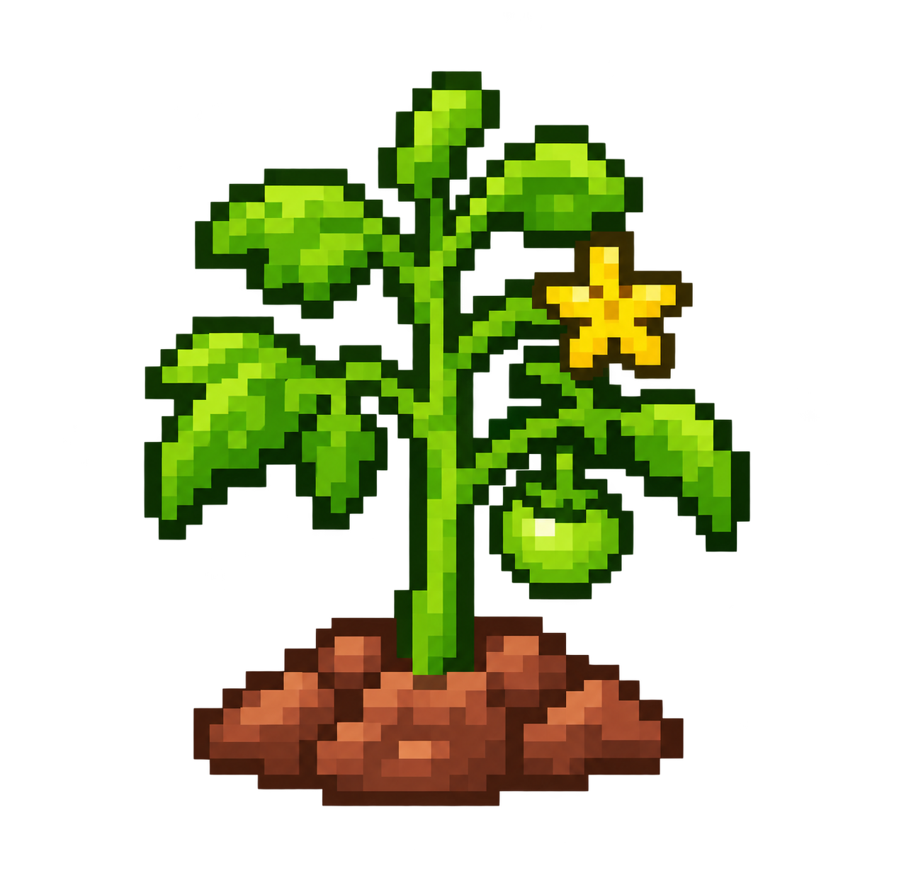
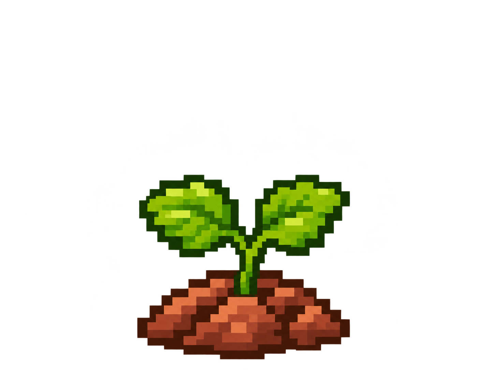
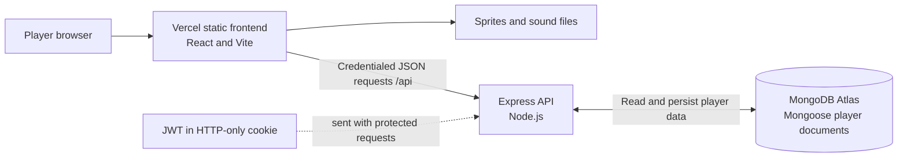

<div align="center">
  
  <h1>Cozy Garden</h1>
  <hr>
  <p><em>Plant a little happiness. Grow a garden of your own.</em></p>
  <p>A gentle pixel-art gardening game where every seed grows in real time. Plant, come back to harvest, collect coins and experience, and build a garden that is yours.</p>
  <p><a href="https://cozy-garden-three.vercel.app/"><strong>🌿 Play Cozy Garden</strong></a></p>
</div>

<p align="center">
  <a href="https://react.dev/"></a>
  <a href="https://vite.dev/"></a>
  <a href="https://nodejs.org/"></a>
  <a href="https://expressjs.com/"></a>
  <a href="https://www.mongodb.com/"></a>
</p>

## 🌷 About Cozy Garden

Cozy Garden is a small, persistent farming game built around the pleasure of planting something and watching it grow. Start with a 4 × 4 plot and 500 coins, choose from six seeds, and return as crops pass through three pixel-art growth stages. Harvesting adds coins and XP to your account; achievements track milestones along the way.

The game is designed for relaxed, asynchronous play: crops continue growing while you are away, and your garden and player progress are saved to your account.

## ✨ Features

- **Player accounts:** Sign up with a username and email, or log in using either username or email. Sessions use a seven-day, HTTP-only authentication cookie.
- **A little starting purse:** New players receive 500 coins and a 16-tile garden.
- **Seed shop and inventory:** Buy six seed varieties with coins; planting consumes one owned seed.
- **A 4 × 4 garden:** Select an empty tile, choose a seed from your inventory, and plant it. Growing tiles show a countdown.
- **Three real-time crop stages:** Sprites change at halfway and full growth. Harvesting is available when a crop is fully grown. A planted crop can be removed after half its growth time.
- **Harvest rewards and levels:** Harvests award coins and XP based on the seed price. Every 100 XP advances a level.
- **Achievements:** Ten milestones cover planting, harvesting, flowers, coins, seed purchases, daily activity, leaderboard position, and achievement collection.
- **Player profile:** View progress and stats, change your username, and save a PNG or JPEG avatar (up to 2 MB).
- **Leaderboard:** Signed-in players are ranked by XP, then level, with a stable creation-time tie-break.
- **Account control:** Players can permanently delete their account and game data from Profile after confirming their password.
- **Privacy and support:** Public Privacy, Terms, and Contact pages explain current data use and mark owner details that must be supplied before launch.
- **Optional analytics:** GA4 can be enabled with `VITE_GA_MEASUREMENT_ID`; the script loads only after consent. See [ANALYTICS.md](ANALYTICS.md).
- **Sound effects:** Short planting and harvest sounds play after successful actions.
- **Persistent progress:** MongoDB stores player, inventory, garden, progression, and achievement data.

## 🌱 Watch Your Garden Grow

Every crop in the game has three distinct sprites. The images below are the same PNGs used by the garden, in growth order.

| Crop | 🌱 Stage 1 : Seedling | 🌿 Stage 2 : Growing | 🌻 Stage 3 : Fully Grown |
|---|---|---|---|
| 🥕 Carrot |  |  |  |
| 🍅 Tomato |  |  |  |
| 🌻 Sunflower |  |  |  |
| 🍓 Strawberry |  |  |  |
| 🎃 Pumpkin |  |  |  |
| 💜 Violet flower |  |  |  |

## 🎮 How to Play

1. [Open the live game](https://cozy-garden-three.vercel.app/) and choose **Sign Up** or **Log In**.
2. Your new account starts with 500 coins and an empty garden. Open the **Shop** to see seed costs and growing times.
3. Buy a seed packet. It appears in your inventory, ready to plant.
4. Open your **Garden**, select an empty tile, choose a seed you own, and plant it.
5. Let the crop grow. Its tile displays a countdown; the artwork changes halfway through and again when it is ready.
6. Select a fully grown crop and harvest it to receive coins and XP. The tile becomes available for another seed.
7. Visit your **Profile** to see stats and achievements, or the **Leaderboard** to see gardeners ranked by XP and level.

A crop can also be removed after it reaches its second growth stage; removing it does not award harvest rewards.

## 🛠️ Tech Stack

| Area | Technologies |
|---|---|
| Frontend | React 19, React DOM, React Router 7, Vite 8 |
| UI and assets | Lucide React icons, HTML-to-image for achievement share cards, CSS, PNG sprites, MP3 sounds |
| Backend | Node.js (20+), Express 5 (ES modules) |
| Data and authentication | MongoDB with Mongoose 8, bcryptjs password hashing, jsonwebtoken, HTTP-only cookies |
| Middleware | CORS, cookie-parser, dotenv |
| Tests and linting | Node.js built-in test runner, ESLint |
| Hosting documented in this repository | Vercel frontend, Heroku API, MongoDB Atlas |

## 🏗️ Project Architecture

The browser serves the React app from Vercel and calls the Express API under `/api`. The API validates requests, reads and updates player documents in MongoDB, and returns JSON. Credentialed requests carry the HTTP-only session cookie; the API checks it for protected routes. Crop maturity is calculated and checked by the server using the planting timestamp.



## 📁 Project Structure

```text
Cozy-Garden/
├── README.md
├── package.json                 # Root deployment scripts and Node engine
├── Procfile                     # Heroku process entry point
├── DEPLOYMENT.md                # Vercel, Heroku, and Atlas deployment notes
├── backend/
│   ├── .env.example              # Local backend configuration template
│   ├── package.json              # API scripts and dependencies
│   ├── src/
│   │   ├── app.js                # Express middleware and route mounts
│   │   ├── server.js             # Database startup and HTTP listener
│   │   ├── config/               # MongoDB connection
│   │   ├── data/                 # Trusted seed catalogue
│   │   ├── middleware/           # Authentication and error handling
│   │   ├── models/               # Mongoose user model
│   │   ├── routes/               # Auth, player, shop, garden, leaderboard
│   │   ├── services/             # Progression and achievements
│   │   └── utils/                 # Garden serialization, tokens, responses
│   └── tests/                    # Progression and achievement tests
└── frontend/
    ├── index.html
    ├── package.json              # Vite scripts and UI dependencies
    ├── public/                   # Favicon, icons, planting and harvest audio
    ├── src/
    │   ├── App.jsx                # Client-side routes
    │   ├── AuthPage.jsx           # Sign-up and login screens
    │   ├── context/               # Shared authentication state
    │   ├── components/            # Garden, crop, profile, and UI components
    │   ├── data/                  # Seed, leaderboard, and achievement UI data
    │   ├── pages/                 # Garden, shop, profile, help, leaderboard
    │   ├── services/              # API requests and game sound playback
    │   ├── styles/                # Page stylesheets
    │   ├── assets/                # Pixel-art crops, stages, icons, backgrounds
    │   └── utils/                 # Client crop-stage calculation
    └── tests/                     # Crop growth-stage tests
```

## 🚀 Getting Started

### Prerequisites

- Node.js 20 or newer and npm
- A MongoDB instance (local MongoDB or MongoDB Atlas)

### Install and configure

```bash
git clone https://github.com/ZainabTravadi/Cozy-Garden.git
cd Cozy-Garden

cd backend
npm install
```

Copy `backend/.env.example` to `backend/.env` and set the values described in [Environment Variables](#-environment-variables). From the `backend` directory, start the API:

```bash
npm run dev
```

In a second terminal, install and start the frontend:

```bash
cd frontend
npm install
npm run dev
```

Vite serves the game at <http://localhost:5173>; the API listens at <http://localhost:5000>. Its health endpoints are <http://localhost:5000/health> and <http://localhost:5000/api/health>. The frontend uses `http://localhost:5000/api` by default. If the API runs elsewhere, set `VITE_API_URL` in the frontend environment to the API base URL ending in `/api`.

## 🔐 Environment Variables

Backend values belong in `backend/.env` (excluded from Git). The checked-in `.env.example` contains safe local placeholders.

| Variable | Required | Purpose |
|---|---:|---|
| `MONGODB_URI` | Yes | MongoDB connection URI, including the database name. |
| `JWT_SECRET` | Yes | Private signing key for seven-day authentication tokens. Use a long, random value. |
| `PORT` | No | API port; defaults to `5000`. Hosting platforms may provide it. |
| `CLIENT_ORIGIN` | Production | Exact browser origin allowed by credentialed CORS. Local default is `http://localhost:5173`. |
| `NODE_ENV` | Production setup | Set to `production` to enable secure cross-site cookies and production proxy handling. |
| `VITE_API_URL` | No | Frontend API base URL including `/api`; defaults to `http://localhost:5000/api`. |
| `VITE_GA_MEASUREMENT_ID` | No | Optional GA4 measurement ID; analytics stays off until the visitor consents. |

Example frontend override (use your own local or deployed API URL):

```dotenv
VITE_API_URL=https://your-api.example.com/api
```

Never place backend secrets in frontend variables; `VITE_` values are bundled for browser access.

## 🔌 API Documentation

All API routes are prefixed with `/api`, except the readiness endpoints `/health` and `/api/health`. JSON request bodies are shown below. Protected endpoints accept the `token` HTTP-only cookie; the auth middleware also accepts a bearer token. The frontend sends credentialed requests. Error responses generally use `{ "message": "..." }`.

| Method | Endpoint | Auth | Purpose |
|---|---|---:|---|
| `GET` | `/health`, `/api/health` | No | Readiness status and MongoDB connection state. |
| `POST` | `/api/auth/signup` | No | Create account, initialize 500 coins and 16 empty plots, and set the auth cookie. |
| `POST` | `/api/auth/login` | No | Authenticate with `{ "identifier": "username-or-email", "password": "…" }`; returns the user and sets cookie. |
| `GET` | `/api/auth/me` | Yes | Return the current public user. |
| `POST` | `/api/auth/logout` | No | Clear the auth cookie; returns `204`. |
| `GET` | `/api/player/profile` | Yes | Return player profile and stats, including `totalSeeds`. |
| `PATCH` | `/api/player/profile` | Yes | Update username and optionally PNG/JPEG `avatarData` as a data URL (max 2 MB). |
| `PATCH` | `/api/player/welcome` | Yes | Save that the first-garden welcome dialog was dismissed. |
| `DELETE` | `/api/player/account` | Yes | Delete the authenticated account and its game data after password confirmation. |
| `GET` | `/api/shop/seeds` | No | Return the server-side seed catalogue. |
| `POST` | `/api/shop/purchase` | Yes | Buy seeds with `{ "seedId": "carrot", "quantity": 1 }` (quantity 1–100). |
| `GET` | `/api/garden` | Yes | Return garden tiles, server time, crop status, and user data. |
| `POST` | `/api/garden/plant` | Yes | Plant an owned seed with `{ "tileId": 0, "seedId": "carrot" }`. |
| `POST` | `/api/garden/harvest` | Yes | Harvest a mature crop with `{ "tileId": 0 }`; response includes `rewardCoins` and `rewardXp`. |
| `POST` | `/api/garden/remove` | Yes | Remove a crop after half its growth duration with `{ "tileId": 0 }`; no rewards. |
| `GET` | `/api/leaderboard` | Yes | Return authenticated-user leaderboard entries ranked by XP, level, and account creation time. |

Successful signup response shape is `{ "user": { ... } }`; harvest returns `{ "garden": [...], "serverTime": "…", "user": { ... }, "rewardCoins": 20, "rewardXp": 10 }`. For example, the shop catalogue response is `{ "seeds": [{ "id": "carrot", "name": "Carrot Seed", "price": 10, "growthTime": "1 hour 30 minutes" }] }`. Password hashes are not included in public user data. Leaderboard entries expose username, level, XP, rank, and whether the row belongs to the signed-in user; they do not expose coin balances, email addresses, or avatar data.

## 📈 Game Progression

| Seed | Cost | Time to harvest | Coins earned | XP earned |
|---|---:|---:|---:|---:|
| Carrot | 10 | 1 h 30 min | 20 | 10 |
| Tomato | 20 | 2 h | 40 | 20 |
| Sunflower | 35 | 4 h | 70 | 35 |
| Strawberry | 30 | 3 h | 60 | 30 |
| Pumpkin | 50 | 6 h | 100 | 50 |
| Violet flower | 25 | 2 h 30 min | 50 | 25 |

Harvest rewards use the trusted seed price: **coins = 2 × seed price** and **XP = seed price**. Buying a seed costs its listed price. Crops are ready after their full listed growth time. Stage 2 begins at halfway; stage 3 begins at completion. Every 100 total XP advances one level: `level = floor(total XP / 100) + 1`; the XP bar shows `total XP mod 100` toward the next level. Sunflowers and violet flowers count toward the flower achievement.

Achievements are awarded for planting 1 seed, harvesting 10 crops, harvesting 10 flowers, earning 5,000 lifetime coins, buying 10 seed packets, playing on 3 consecutive days, playing on 7 consecutive days, harvesting 50 crops, and reaching first place on the leaderboard. **Master Gardener** unlocks after nine other achievements.

## 🔊 Sound Design

The game includes `frontend/public/sounds/planting.mp3` and `harvest.mp3`. A successful planting plays the planting sound; a successful harvest plays the harvest sound. Playback uses 35% volume and is stopped after two seconds. If the browser blocks audio playback, the game logs a warning and continues.

## 🧪 Testing

Both packages use Node's built-in test runner. From the corresponding directory, run:

```bash
# Backend progression and achievement rules
cd backend
npm test

# Frontend crop growth stages
cd ../frontend
npm test
```

The frontend package also provides `npm run lint` and `npm run build`; `npm run preview` serves a built frontend locally.

## 🌐 Deployment

The repository's [deployment guide](DEPLOYMENT.md) describes the intended split deployment: the Vite frontend on Vercel, Express API on Heroku, and MongoDB Atlas for data. The currently referenced frontend is [cozy-garden-three.vercel.app](https://cozy-garden-three.vercel.app/) and its deployed bundle points to `https://cozy-garden-backend-41e83e1826bf.herokuapp.com/api`. A read-only smoke check on 14 November 2026 found the API healthy and database connected; the deployed frontend still returns 404 for nested pages and the newly added SEO assets until this change is deployed. The root `Procfile` runs the backend, and the root postbuild script installs its production dependencies. Configure the API's `MONGODB_URI`, `JWT_SECRET`, and deployed `CLIENT_ORIGIN`; configure the frontend's `VITE_API_URL` to the API URL ending in `/api`.

The frontend includes Vercel SPA fallback and security header configuration in `frontend/vercel.json`. For the deployed game, visit [cozy-garden-three.vercel.app](https://cozy-garden-three.vercel.app/); this repository cannot verify its live health.

## 🤝 Contributing

Issues and pull requests are welcome. Before opening a change, create a focused branch from `main`, keep the change scoped, and describe what you changed and how you checked it. Run the relevant package tests; for frontend changes, also run the lint and build scripts. Include screenshots for visible UI changes where helpful.

## 💚 A Final Note

May your seedlings be cheerful, your harvests plentiful, and your little corner of Cozy Garden always growing. 🌱
